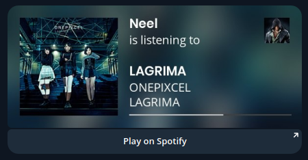
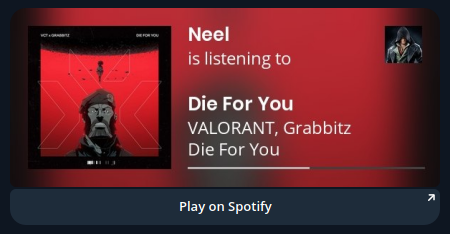

# 🎵 Spotipie bot

Your music, turned into listening cards for Telegram. Share what's playing on Spotify, catch up with your Last.fm scrobbles, and bring your listening activity into the conversation.

Originally built in Python and now written in Go, Spotipie combines Spotify and Last.fm with customizable listening cards. Album artwork, track details, and your chosen display name come together in an image you can share directly in Telegram.

🎧 Share your current Spotify track without leaving the chat.

📻 Show what you've been listening to with Last.fm scrobbles and play counts.

🎨 Make your cards your own with custom display names and different styles.

💬 Share listening cards through Telegram inline queries.

🔐 Connect Spotify through an authorization flow tied to your Telegram account, with expiring, single-use sessions.

## Available Commands

- `/now` - Share currently playing Spotify track
- `/register` - Link Spotify account
- `/name` - Set Spotify display name
- `/style` - Change background style
- `/unregister` - Unlink Spotify account
- `/linkfm` - Link Last.fm account
- `/namefm` - Set Last.fm display name
- `/last` - Share recent Last.fm track
- `/unlinkfm` - Unlink Last.fm account

## Alternatives

[SpotifyNowBot](https://github.com/notdedsec/SpotifyNow): Python Telegram bot to share what you're listening to on Spotify.

## Support

If you're enjoying Spotipie bot, drop a ⭐️ on the repo!

## Star History

<a href="https://www.star-history.com/?repos=neelplaysac%2Fspotipie-bot">
 <picture>
   <source media="(prefers-color-scheme: dark)" srcset="https://api.star-history.com/chart?repos=neelplaysac/spotipie-bot&type=date&theme=dark&legend=top-left" />
   <source media="(prefers-color-scheme: light)" srcset="https://api.star-history.com/chart?repos=neelplaysac/spotipie-bot&type=date&legend=top-left" />
   
 </picture>
</a>
